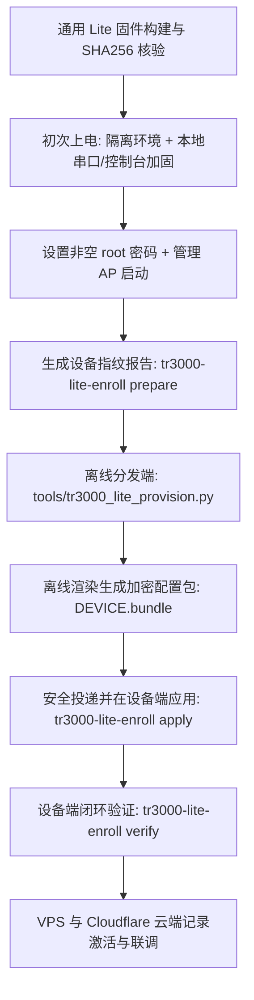

# TR3000-Lite 设备预配与入网指南 (Provisioning Runbook)

本文档定义 Cudy TR3000-Lite 工业网关从固件刷写、初始安全加固、离线配置生成、安全上机预配 (Enrollment) 到云端/VPS 联调的完整规范。

> [!IMPORTANT]
> 仓库代码与镜像产物中**绝不包含任何生产密钥、API Token、VPS 真实公网 IP 或客户私有现场配置**。本文档中的所有 IP、域名、公私钥与 Token 均为占位符示例。

---

## 1. 预配流水线概述 (Two-Phase Staging Pipeline)

Lite 固件采取严格的“通用固件 + 设备逐台加密预配”两阶段架构：



---

## 2. 初始安全加固 (Phase 0)

1. **环境隔离**：新设备首次上电必须在受控工位进行，**严禁将设备 LAN (plant) 接口接入工业现场交换机/HUB**。
2. **本地控制台加固**：
   - 通过 USB-to-UART 串口或连接管理 Wi-Fi（默认由接入段 `lan` 分配 `192.168.10.x` 地址）。
   - 执行 `passwd` 设置强口令 root 密码。
   - 检查 `/etc/tr3000-lite/management-ap.initialized` 确认无线管理平面已正常初始化。
   > [!CAUTION]
   > 若 root 密码为空，固件内置门禁会永久阻断所有 WireGuard 监听、Plant HTTPS 暴露及远程同步。

---

## 3. 设备指纹采集 (Device Preparation)

在待入网网关控制台上执行：

```sh
/usr/sbin/tr3000-lite-enroll prepare > /tmp/prepare-report.json
```

该命令仅采集设备的公开非敏感身份指纹：
- `device_id`：设备出厂唯一标识（如 `TR3000-LITE-B001`）
- `lan_mac` / `wan_mac`：硬件 MAC 地址
- `factory_hash`：Factory 分区 SHA256 前缀，用于绑定硬件身份
- `status`：`ready_for_enrollment`

将 `prepare-report.json` 安全拷贝至离线管理工作站。

---

## 4. 离线清单与配置生成 (Offline Provisioning)

在离线安全工作站（非路由器本地）使用 `tools/tr3000_lite_provision.py` 工具。

### 4.1 离线清单文件 (`inventory.json`) 格式

清单严格保存在离线工作站（已加 `.gitignore`），禁止入库：

```json
{
  "schema_version": 1,
  "identity": "TR3000-LITE-B001",
  "wg_direct": {
    "private_key": "<32-byte-base64-private-key>",
    "address": "10.77.0.2/32",
    "listen_port": 51820,
    "peers": [
      {
        "name": "engineer_primary",
        "public_key": "<32-byte-base64-public-key>",
        "allowed_ips": ["10.77.0.10/32"]
      }
    ]
  },
  "wg_vps": {
    "private_key": "<32-byte-base64-private-key>",
    "address": "10.88.0.2/32",
    "endpoint_host": "vps.example.com",
    "endpoint_port": 51820,
    "persistent_keepalive": 25,
    "peers": [
      {
        "name": "vps_server",
        "public_key": "<32-byte-base64-public-key>",
        "allowed_ips": ["10.88.0.1/32", "10.88.0.20/32"]
      }
    ]
  },
  "policy": {
    "allow_luci": true,
    "allow_plant": true,
    "vps_remote_sources": ["10.88.0.20/32"]
  },
  "ddns": {
    "enabled": true,
    "domain": "tr3000-b001.example.com",
    "zone": "example.com",
    "token": "<cloudflare-scoped-dns-edit-token>"
  }
}
```

### 4.2 清单校验与配置包渲染

```sh
# 1. 校验清单结构与 IP/密钥规范
python3 tools/tr3000_lite_provision.py validate --inventory inventory.json

# 2. 渲染为设备配置包 (Device Bundle)
python3 tools/tr3000_lite_provision.py render \
  --inventory inventory.json \
  --output TR3000-LITE-B001.bundle
```

渲染产物包 `TR3000-LITE-B001.bundle` 内部包含：
- `manifest.json`：包含清单 SHA256 与目标 `device_id`
- `keys/direct.key` 与 `keys/vps.key`：独立 WireGuard 私钥（权限 `0600`）
- `uci/network.fragment`：包含 `wg_direct` 与 `wg_vps` 接口定义及严格 `/32` AllowedIPs
- `uci/tr3000-lite-remote.fragment`：策略基线
- `uci/ddns.fragment`：DDNS 配置片段（含加密传递的 API Token）

---

## 5. 设备端入网与生效 (Device Enrollment)

将渲染生成的 `TR3000-LITE-B001.bundle` 传至设备的 `/tmp` 目录（例如通过 SFTP/SCP）：

```sh
# 1. 执行原子应用
/usr/sbin/tr3000-lite-enroll apply --bundle /tmp/TR3000-LITE-B001.bundle

# 2. 验证入网状态
/usr/sbin/tr3000-lite-enroll verify

# 3. 及时清理传输的临时配置包
rm -rf /tmp/TR3000-LITE-B001.bundle
```

`apply` 流程自动保证：
- 严格校验 `manifest.json` 中的 `identity` 与本机出厂标识匹配；
- 将私钥解密并以 `0600` 权限部署至 `/etc/tr3000-lite/keys/`；
- 执行 UCI 候选段合并，并调用 `fw4 check` 预检；
- 生成 `/etc/tr3000-lite/enrolled` 锁标记；
- 触发 `/usr/sbin/tr3000-lite-remote sync` 同步生效底层 nftables 链与 SNAT。

---

## 6. 云端服务注册与联调 (Cloud & VPS Side)

### 6.1 Cloudflare DDNS 规范
1. 在 Cloudflare 控制台创建专属 API Token，权限仅限：`Zone - DNS - Edit`，资源限定为目标单一 Zone。
2. DNS 记录类型：`A` 记录，**必须开启 DNS-only（灰色云朵，关闭 Cloudflare CDN 代理）**，以支持 WireGuard UDP 51820 穿透。
3. 设备入网后，调用 `/usr/sbin/tr3000-lite-ddns-status --json` 确认 DDNS 成功获取公网 IP 并更新。

### 6.2 VPS WireGuard 服务端配置
在 VPS (`/etc/wireguard/wg0.conf`) 中注册对应的 TR3000 网关 Peer：

```ini
# [Peer: TR3000-LITE-B001]
[Peer]
PublicKey = <TR3000_vps.key_对应的公钥>
AllowedIPs = 10.88.0.2/32, 192.168.20.0/24
```

> [!NOTE]
> VPS 上 TR3000 Peer 的 `AllowedIPs` 需包含设备隧道 IP (`10.88.0.2/32`) 以及经批准的现场工业网段 (默认 `192.168.20.0/24`)。`192.168.10.0/24` 是操作员接入段（`lan`），不得当作工业网段发布。

---

## 7. 设备退役与吊销流程 (Revocation & Decommissioning)

若设备维修、移交或退役：
1. **云端立即吊销**：
   - 在 VPS 上注释或删除该网关的 `[Peer]` 配置并 `wg syncconf`；
   - 在 Cloudflare 控制台吊销该设备的 API Token 并删除其 DNS 记录；
   - 工程师终端从 WireGuard 配置中移除该设备的 Direct Peer。
2. **设备端清理**：
   - 串口控制台执行 `firstboot -y && reboot` 清理所有本地私钥、备份与 UCI 记录；
   - 或刷写官方初始 sysupgrade 固件重新初始化。
